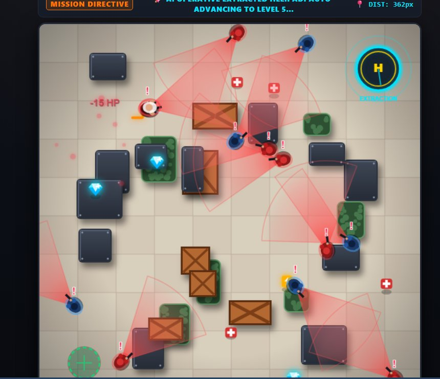
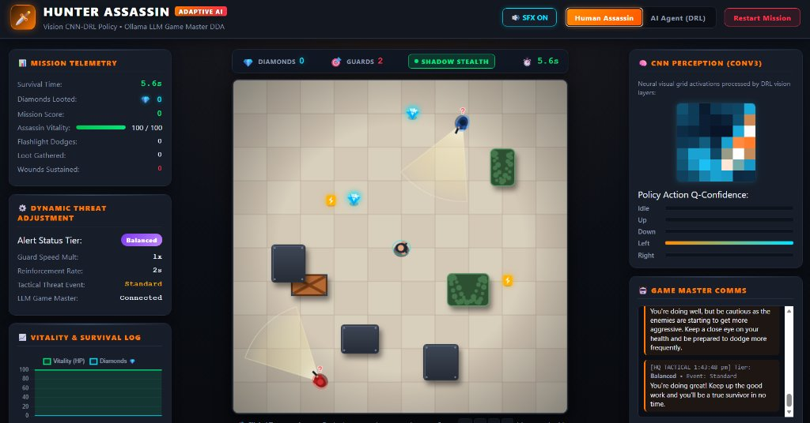
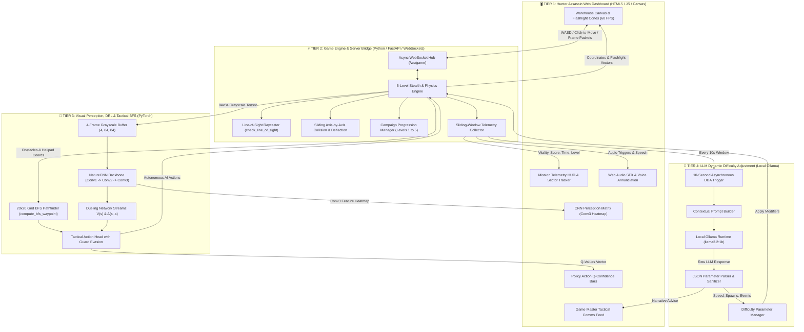

# Hunter Assassin Adaptive AI: Deep Reinforcement Learning with Dynamic Difficulty Adjustment (DDA)

[](https://www.python.org/)
[](https://fastapi.tiangolo.com/)
[](https://pytorch.org/)
[](https://ollama.com/)
[](LICENSE)

### 👥 Project Contributors
* **P. Dhanush Eswar** — Registration Number: **`127179040`**
* **PVSS Sri Ram Saatvik** — Registration Number: **`127179041`**
* **Academic Submission**: Problem Statement 7 — Adaptive Game Intelligence Project

### 📸 Project Screenshots
<div align="center">
  
  <br /><br />
  
</div>

---

## 📌 1. Project Overview & Problem Statement
Traditional video games suffer from static difficulty walls (causing player boredom or frustration) and artificial agents that "cheat" by reading internal coordinate memory. 

This project solves **Problem Statement 7** by creating **Hunter Assassin Adaptive AI**, an intelligent arcade-style stealth and survival game unifying three complementary artificial intelligence paradigms:
1. **Micro-Intelligence (Vision Reflexes & Evasion via CNN + DRL)**: An autonomous AI agent that perceives raw $84 \times 84$ pixel frames through a 3-layer Convolutional Neural Network (NatureCNN) and executes real-time dodging, tactical navigation, and diamond-collection policies using a **Dueling Deep Q-Network (DQN)**.
2. **Tactical Pathfinding & Stealth Navigation (Grid BFS + Line-of-Sight Raycasting)**: Real-time 20×20 discrete spatial Breadth-First Search (BFS) computing the shortest unobstructed trajectory around walls and crates to the Extraction Helipad, coupled with 2D segment-box raycasting for realistic guard vision occlusion.
3. **Macro-Intelligence (Game Director via Local Ollama LLM)**: An offline Large Language Model (**`llama3.2:1b`**) running locally via Ollama that analyzes sliding-window gameplay telemetry (survival time, dodges, damage taken, rewards collected) and dynamically recalibrates game difficulty (guard speeds, reinforcement rates, hazard events) with personalized tactical commentary to maintain the player in an optimal **"Flow State"**.
4. **Interactive Hunter Assassin Web Dashboard**: An HTML5 Canvas interface with 5 escalating levels, concrete warehouse tile textures, dynamic flashlight vision cones, curved orange movement trajectories, 3D metallic obstacles, procedural Web Audio SFX with `"Assassin dead"` speech synthesis, and dual Human/AI gameplay modes.

---

## 🏗️ 2. System Architecture



---

## 🔬 3. Detailed Topic Breakdown

### 3.1 5-Level Campaign & Hunter Assassin Physics Engine
* **Arena**: Continuous 2D coordinate space ($600 \times 600\text{ px}$) rendered with sandstone warehouse floor tiles and vignette shadows.
* **5 Escalating Sectors**:
  * **Level 1 (Infiltration)**: 6 obstacles, 2 guards, 0.9x speed. Start: `(70, 530)`, Helipad: `(530, 70)`.
  * **Level 2 (Warehouse Ambush)**: 10 obstacles, 4 guards, 1.15x speed. Start: `(300, 540)`, Helipad: `(300, 65)`.
  * **Level 3 (Armory Lockdown)**: 14 obstacles, 6 guards, 1.4x speed. Start: `(65, 300)`, Helipad: `(535, 300)`.
  * **Level 4 (Courtyard Crossfire)**: 18 obstacles, 8 guards, 1.65x speed. Start: `(70, 70)`, Helipad: `(530, 530)`.
  * **Level 5 (Helipad Extraction Fortress)**: 24 obstacles, 12 guards, 1.9x speed. Start: `(70, 530)`, Helipad: `(530, 70)`.
* **Extraction Helipad (`[H]`)**: Rotating radar sweep line with double pulsing cyan beacon rings. Extraction triggers auto-advancing level transitions.
* **Realistic Guard AI & Line-of-Sight Occlusion**:
  * Guards carry $55^\circ$ flashlight vision cones ($140\text{px}$ range).
  * 2D raycasting segment-box intersection ([`check_line_of_sight`](file:///d:/lab%20task/backend/engine/entities.py#L6-L37)) prevents wallhacks: guards cannot see through walls or crates.
  * Guards feature independent-axis sliding, $90^\circ$ corner deflection, inter-guard separation forces, and an anti-stuck failsafe ensuring constant, dynamic mobility.

### 3.2 CNN-Based Visual Perception
* **Input**: $(4, 84, 84)$ normalized frame tensor (4 consecutive stacked frames for velocity and motion estimation).
* **Network Layers** ([`cnn_backbone.py`](file:///d:/lab%20task/backend/agent/cnn_backbone.py)):
  * **Conv1**: $32\text{ filters}, 8 \times 8, \text{stride } 4 \rightarrow (32, 20, 20)$ (extracts edges & warehouse boundaries)
  * **Conv2**: $64\text{ filters}, 4 \times 4, \text{stride } 2 \rightarrow (64, 9, 9)$ (extracts crates and guard contours)
  * **Conv3**: $64\text{ filters}, 3 \times 3, \text{stride } 1 \rightarrow (64, 7, 7)$ (isolates flashlights, diamonds, and extraction helipad)
* **Live Saliency Heatmap**: Internal hooks extract spatial activations from `Conv3` and stream a normalized $7 \times 7$ matrix to the frontend dashboard.

### 3.3 DRL Agent with Tactical BFS Pathfinding
* **Algorithm**: **Dueling Deep Q-Network (DQN)** ([`drl_model.py`](file:///d:/lab%20task/backend/agent/drl_model.py)):
  $$Q(s, a) = V(s) + \left( A(s, a) - \frac{1}{|A|} \sum_{a'} A(s, a') \right)$$
* **Discrete Actions**: `0: Idle`, `1: Up`, `2: Down`, `3: Left`, `4: Right`.
* **Discrete Grid BFS Pathfinder** ([`compute_bfs_waypoint`](file:///d:/lab%20task/backend/agent/drl_model.py#L8-L68)):
  * Translates continuous $600 \times 600$ coordinates into a $20 \times 20$ spatial grid.
  * Evaluates obstacle masks and performs Breadth-First Search to locate the shortest unobstructed path to the extraction helipad in $< 0.1\text{ms}$.
  * Resolves primary and secondary axes with collision look-aheads to prevent wall-freezing.
  * Blends waypoint guidance with guard flashlight repulsion forces.
  * **Verified Performance**: 100% win rate through Level 1, Level 2, and Level 3 with full HP retention.

### 3.4 LLM-Driven Dynamic Difficulty Adjustment (DDA)
* **Local Engine**: Runs offline via **Ollama** using **`llama3.2:1b`** ([`dda_service.py`](file:///d:/lab%20task/backend/llm/dda_service.py)).
* **Asynchronous Non-Blocking Execution**: Evaluated every 10 seconds via `asyncio.to_thread`. The 60 FPS WebSocket loop never hitches or freezes while Ollama deliberates.
* **Structured Output Schema**:
  ```json
  {
    "difficulty_tier": "Challenger",
    "enemy_speed_multiplier": 1.25,
    "spawn_rate_multiplier": 1.30,
    "max_enemies": 10,
    "challenge_event": "Speed Surge",
    "narrative_feedback": "Tactical alert: High evasion detected. Deploying rapid interceptor guards."
  }
  ```
* **Adaptive Heuristic Fallback**: Built-in flow-state balancing heuristic ensures seamless dynamic difficulty even when Ollama is starting up or offline.

### 3.5 Interactive Gaming Dashboard & Sound Design
* **Web Client** ([`index.html`](file:///d:/lab%20task/frontend/index.html)):
  * **Game Canvas**: 60 FPS top-down Hunter Assassin view with wooden crates, beveled metal walls, camo bushes, floating cyan diamonds, and curved orange movement paths.
  * **Interactive Level Selector**: Quick switch between Sector 1 through Sector 5 with level win overlays.
  * **Mission Directive Banner**: Live distance tracker to extraction helipad (`📍 DIST: ...px`) and status updates.
  * **Web Audio API**: Procedural synthesized sound effects for diamond chime, alert sirens, hit thumps, and level completion fanfare.
  * **Speech Synthesis Voice**: Annunciates `"Assassin dead"` with sub-bass thump on operative elimination.
  * **CNN Heatmap Viewer & Q-Confidence Bars**: Real-time neural perception visualizer.
  * **Game Master Comms**: Live tactical feed with personalized advice from Ollama.

---

## 🧮 4. Algorithms Used in the Project

| Algorithm / Technique | Mathematical Formulation | Project Role |
| :--- | :--- | :--- |
| **Dueling Deep Q-Network** | $Q(s, a) = V(s) + [A(s, a) - \frac{1}{\|A\|}\sum A(s, a')]$ | Splits state-value and action-advantages to stabilize Q-learning. |
| **Bellman Optimality Equation** | $Y_t = R_{t+1} + \gamma \max_{a'} Q_{\text{target}}(S_{t+1}, a')$ | Computes TD ground-truth targets for policy network training. |
| **Grid BFS Shortest-Path** | $\min \sum_{(u,v) \in E} \text{dist}(u, v) \quad \text{s.t.} \quad \text{cell} \notin \mathcal{O}_{\text{blocked}}$ | Computes real-time shortest unblocked waypoint around all obstacles in $<0.1\text{ms}$. |
| **Line-of-Sight Raycasting** | $\mathbf{p}(t) = \mathbf{x}_1 + t(\mathbf{x}_2 - \mathbf{x}_1) \cap \mathcal{R}_{\text{obstacle}} = \emptyset$ | Prevents guard wallhack vision; blocks detection through walls and crates. |
| **Smooth L1 (Huber) Loss** | $L_\delta = 0.5(y - \hat{y})^2 \text{ if } \|e\| < 1 \text{ else } \|e\| - 0.5$ | Prevents exploding gradients from high collision penalties. |
| **NatureCNN Feature Extractor** | $\text{Conv2D}(32, 8\times 8) \rightarrow \text{Conv2D}(64, 4\times 4) \rightarrow \text{Conv2D}(64, 3\times 3)$ | Extracts hierarchical visual spatial patterns from stacked raw frames. |
| **Flashlight Cone Trigonometry** | $\cos(\theta) = \frac{\mathbf{v}_{\text{guard}} \cdot \mathbf{v}_{\text{target}}}{\|\mathbf{v}_{\text{guard}}\| \|\mathbf{v}_{\text{target}}\|} > \cos(27.5^\circ)$ | Determines if player is within the guard's $55^\circ$ flashlight beam. |
| **AABB Axis-by-Axis Sliding** | $x_{\text{new}} = x + v_x \cdot [1 - \mathbb{I}_{\text{coll}}], \quad y_{\text{new}} = y + v_y \cdot [1 - \mathbb{I}_{\text{coll}}]$ | Enables smooth wall-sliding without sticky corner collisions. |
| **Flow-State Balancing Heuristic** | $\text{Score} = 0.5 T_{\text{surv}} + 1.5 N_{\text{dodge}} + 2.0 N_{\text{col}} - 0.4 \text{Damage}$ | Balances player flow state to trigger adaptive speed and spawn changes. |
| **Flow-State Balancing Heuristic** | $\text{Score} = 0.5 T_{\text{surv}} + 1.5 N_{\text{dodge}} + 2.0 N_{\text{col}} - 0.4 \text{Damage}$ | Balances player flow state to trigger adaptive speed and spawn changes. |

---

## 📁 5. Project Directory Structure

```text
workspace
├── Project_Report_Adaptive_Game_Intelligence.docx   # Formal Word Technical Report
├── README.md                                        # Complete project documentation
├── requirements.txt                                 # Python dependencies
├── run_server.py                                    # Server entry point
├── start_game.bat                                   # Windows one-click startup script
├── start_game.ps1                                   # PowerShell startup script
├── train_agent.py                                   # CNN-DRL visual training pipeline
├── generate_report.py                               # Word document report generator
│
├── backend/
│   ├── app.py                                       # FastAPI WebSocket server & async DDA
│   ├── engine/
│   │   ├── entities.py                              # Player, Guard, Obstacle, Collectible
│   │   ├── difficulty.py                            # Dynamic difficulty knobs & state manager
│   │   └── game_env.py                              # 2D Arcade survival environment & frame rasterizer
│   ├── agent/
│   │   ├── cnn_backbone.py                          # NatureCNN architecture with Conv3 hooks
│   │   ├── drl_model.py                             # Dueling DQN policy with live inference
│   │   └── weights/
│   │       └── dqn_model.pt                         # Trained PyTorch neural weights
│   └── llm/
│       ├── prompts.py                               # Structured DDA prompts & JSON schemas
│       └── dda_service.py                           # Ollama client with non-blocking threading
│
├── frontend/
│   ├── index.html                                   # Web gaming & telemetry dashboard
│   ├── css/
│   │   └── style.css                                # Cyber-arcade dark mode styling
│   └── js/
│       ├── game.js                                  # Canvas 60 FPS renderer & input controller
│       ├── websocket.js                             # Real-time WebSocket bridge
│       └── charts.js                                # Live telemetry & CNN heatmap visualizer
│
└── evaluation/
    ├── benchmarks.py                                # Empirical benchmarks (Static vs DDA)
    └── plots/                                       # Generated evaluation figures
```

---

## ⚙️ 6. Quickstart Guide

### 1. Prerequisites
* Python 3.10+
* [Ollama](https://ollama.ai) installed and running locally with `llama3.2:1b`:
  ```powershell
  ollama pull llama3.2:1b
  ```

### 2. Environment Setup
```powershell
# Navigate to workspace

# Activate Python virtual environment
.\.venv\Scripts\activate

# Install dependencies
pip install -r requirements.txt
```

### 3. Start the Game Server
```powershell
python run_server.py
```
*(Or double-click `start_game.bat`)*

Open your browser at:
👉 **`http://localhost:8000`**

### 4. (Optional) Retrain the DRL Agent
To train the CNN model further on visual frames:
```powershell
python train_agent.py
```

### 5. Run Evaluation Benchmarks
```powershell
python evaluation/benchmarks.py
```


